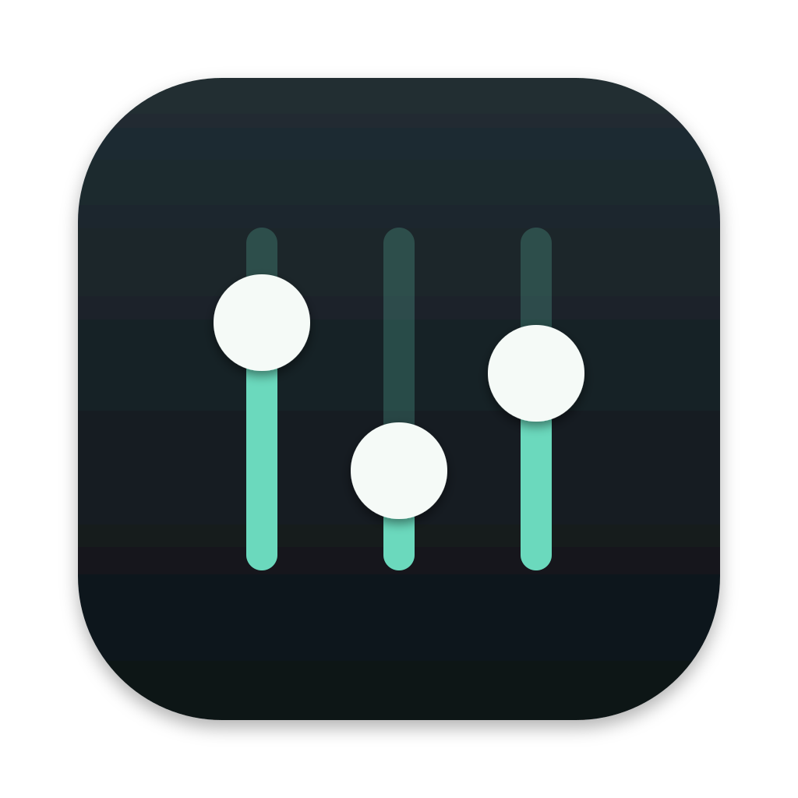
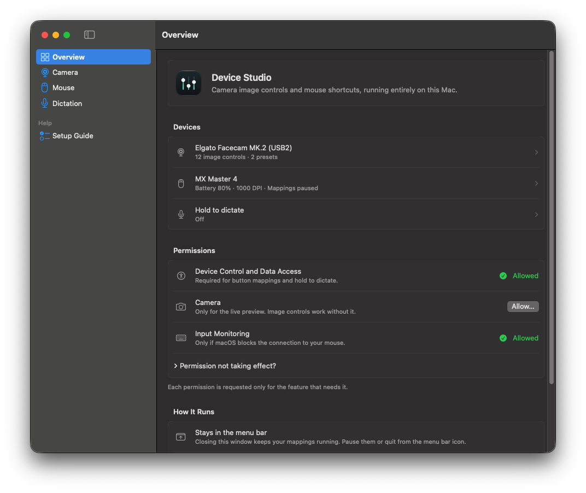
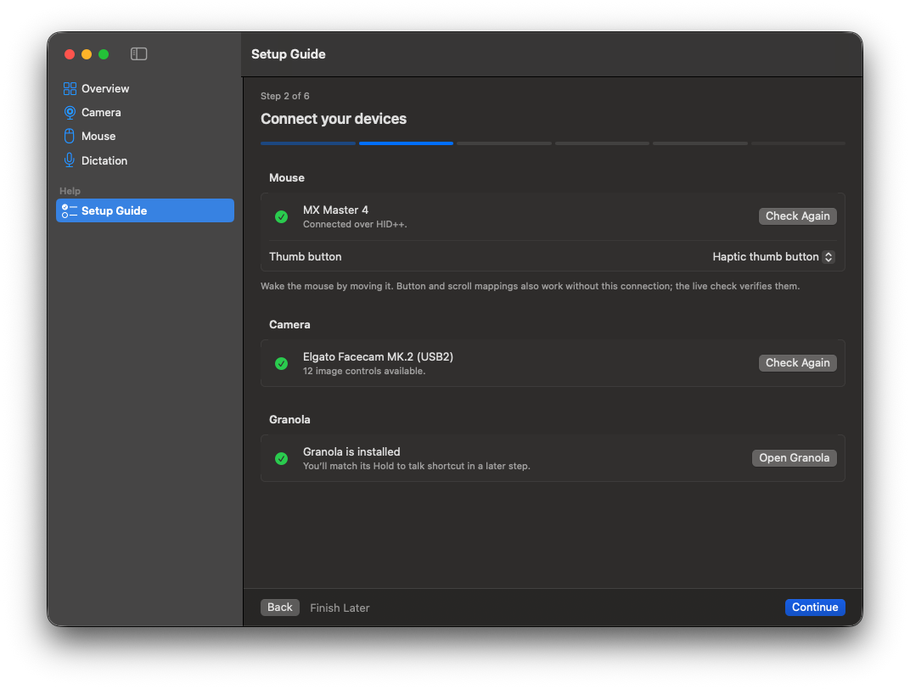
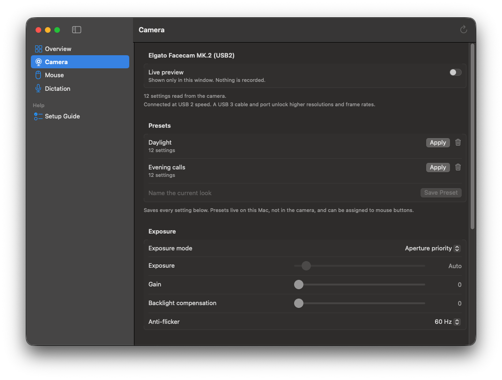
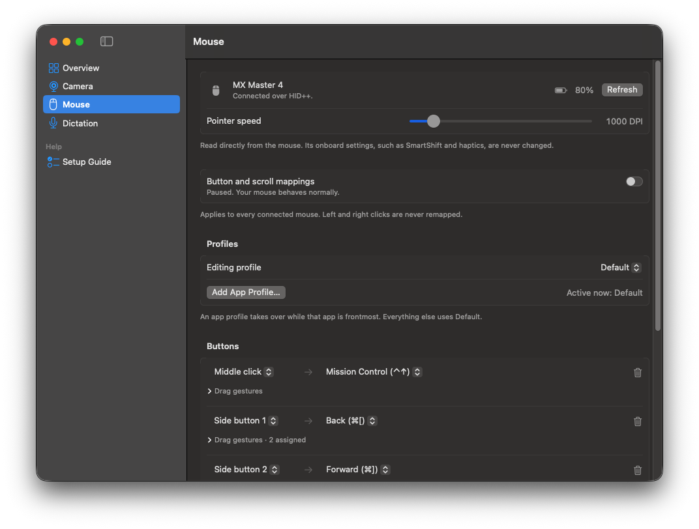

<p align="center">
  
</p>

<h1 align="center">Device Studio</h1>

<p align="center">
  A small native Mac app for tuning an Elgato camera and customizing a Logitech MX mouse.<br>
  No account, no background service, no network requests.
</p>

<p align="center">
  
</p>

## What it does

- **Camera image controls.** Exposure, white balance, focus, zoom, and the rest of the camera's hardware settings, written straight to the camera over USB. Save looks as presets.
- **Mouse shortcuts and scrolling.** Map the extra buttons to keyboard shortcuts, navigation, or camera presets. Add hold-and-drag gestures, change scroll speed and direction, and keep separate profiles per app.
- **Hold to dictate.** Hold the MX Master thumb button to hold [Granola](https://www.granola.ai)'s voice-typing key; release to stop.
- **Live meeting transcripts.** Transcribe your microphone ("Me") and, for calls, what your Mac plays ("Them") live as people speak, then write notes when the meeting ends. Start and stop from the Meetings page, the menu bar, or a mouse button. By default only the transcript is kept, encrypted on your Mac; audio is kept only if you turn that on. Needs a local engine folder (see [Transcripts and notes](#transcripts-and-notes)).

Each feature is optional. A setup guide walks through the ones you pick.

## Requirements

- macOS 14.2 or later (meeting recording uses Core Audio process taps, added in 14.2)
- To build from source: Apple's command-line developer tools (`xcode-select --install`)

| Hardware | Status |
| --- | --- |
| Elgato Facecam MK.2 (USB) | Tested: 12 image controls |
| Logitech MX Master 4 (Logitech receiver) | Tested: battery, pointer speed, both thumb buttons |
| Other Elgato cameras | Should work if they expose standard UVC controls; untested |
| Other cameras | Preview only |
| Other Logitech HID++ mice, or Bluetooth | Checked at runtime for what they support; untested |
| Any mouse | Button and scroll mappings work with any mouse macOS sees |

## Install

There is no prebuilt download yet. From a clone of this repository:

```sh
./scripts/build-app.sh --install
open "$HOME/Applications/Device Studio.app"
```

This builds a release binary, wraps it in an app bundle with its icon, signs it locally, and copies it to `~/Applications`. The project has no dependencies beyond the macOS SDK.

To publish a signed, notarized build for other people, see [DISTRIBUTING.md](DISTRIBUTING.md).

## First launch

<p align="center">
  
</p>

The app opens on a setup guide. You choose what to set up, and it:

1. Finds your devices and reports what each one supports.
2. Asks for only the macOS permissions those features need.
3. Has you match Granola's **Hold to talk** key, if you chose dictation.
4. Runs a live check: press the button, scroll the wheel, see the picture. Dictation only passes once you confirm words appeared and stopped.

Progress is saved, so you can leave and come back. Reopen the guide any time from the sidebar or the menu bar icon.

Closing the window leaves Device Studio running in the menu bar. Quit from its menu or with ⌘Q.

## Permissions

| Permission | Needed for | Notes |
| --- | --- | --- |
| Accessibility | Button mappings, hold to dictate | Reads mouse events and presses keys for you. Called "Device Control and Data Access" on macOS 27. |
| Camera | Live preview | Image controls work without it. |
| Input Monitoring | Talking to the mouse | Only if macOS blocks the connection. Reopen the app after granting it. |
| Microphone | Meeting recording | Asked the first time you record, after an explanation of what is recorded. |
| System Audio Recording Only | Recording the other people on a call | Asked the first time a call is recorded. Audio only: no screen or video. If it is off, recordings carry your microphone only and the Meetings page says so. |

macOS ties a permission to one specific copy of an app. If a switch is on in System Settings but the app still reports it missing, remove the Device Studio entry with **−**, add `~/Applications/Device Studio.app` again with **+**, and reopen the app. This is most common after rebuilding from source with an ad-hoc signature, which gets a new identity each time. `build-app.sh` signs with an Apple Development identity when your keychain has one (a free Apple account's Personal Team is enough), which keeps permissions across rebuilds.

## Using it

### Camera

<p align="center">
  
</p>

Controls are grouped into Exposure, Color, Image, and Lens. Only the controls your camera reports are shown, with their real ranges. A slider is disabled while the camera is driving that value automatically; switch the matching automatic mode off to take over.

- Changes apply immediately and affect every app using the camera.
- A preset stores every control's current value. Presets live on your Mac, not in the camera's memory, and can be triggered from a mouse button.
- The live preview is optional and is never recorded.
- A camera on a USB 2 cable or port is limited in resolution and frame rate. The app tells you when that's the case.

### Mouse

<p align="center">
  
</p>

Turn on **Button and scroll mappings** to make your rules live. They start paused each time the app launches, and you can pause them from the menu bar.

- **Buttons.** Assign the middle click and side buttons to a recorded keyboard shortcut, Back, Forward, Mission Control, Show Desktop, or a camera preset. With mappings on, the page shows which button you last pressed, so you can identify one before assigning it.
- **Drag gestures.** Hold a button, drag about 45 points in a direction, and release. A plain click still runs the button's main action.
- **Scrolling.** Speed and direction for the wheel and thumb wheel. Smooth scrolling is left alone unless you opt in, because macOS can't tell a smooth wheel from a trackpad.
- **Profiles.** Add a profile for an app and it takes over while that app is frontmost.
- **Pointer speed.** Shown when the mouse reports an adjustable DPI range.

Two limits worth knowing:

- Mappings apply to **every connected mouse**. Standard macOS mouse events don't say which device they came from.
- Left and right clicks are never remapped. Some buttons are handled inside the mouse and never reach macOS as clicks, so they can't be mapped here.

Mission Control and Show Desktop send the default macOS shortcuts (⌃↑ and F11). If you've changed those in System Settings, record your own shortcut instead.

### Dictation

Turn on **Hold thumb button to dictate**, choose which thumb button, and choose the key that matches Granola → Settings → Voice typing → Hold to talk. Then click into any text field, hold the button, speak, and release.

Device Studio only holds the key. Granola does the listening and typing, and Device Studio never sees the audio or the transcript. If Granola isn't running, it is opened in the background.

This works independently of button mappings. Don't assign the same thumb button in Logi Options+ or another utility at the same time.

## Transcripts and notes

Device Studio does not bundle speech or language models. Point the Meetings page at a folder that holds:

- `engine/target/release/engine-transcribe` and `engine-worker`: speech-to-text with [Parakeet TDT 0.6B v3](https://huggingface.co/nvidia/parakeet-tdt-0.6b-v3) (CC-BY-4.0) through transcribe.cpp. The model file is checked against its pinned size and SHA-256 before every use.
- `.venv/bin/python` and `notes-runner/run_notes.py`: a local notes pipeline on an MLX language model.

Both run as child processes with network access denied, read audio and text through a pipe, and write nothing to disk; Device Studio saves the transcript and notes encrypted with the meeting's key. During a meeting, one speech engine per channel runs in streaming mode: audio goes to it a second at a time and each line appears in the Live Transcript window about a second after the speaker pauses. The transcript is saved after every line, so a crash keeps it. Audio is not written to disk unless **Keep audio** is on. Your microphone is labelled "Me" and system audio "Others"; when your microphone picks up the call through speakers, the repeated lines are dropped. Without an engine folder, recording still works and notes can be made later.

### Names on Google Meet calls

The `ChromeExtension` folder is a small Chrome extension that tells Device Studio who is speaking on a Google Meet call, so lines show the person's name instead of "Others". While Device Studio is recording, the extension turns on Meet's captions, reads each caption's speaker and words on `meet.google.com` only, and passes them through Chrome native messaging to the running app over a socket only your user account can open. Device Studio gives each system-audio line the name whose captions match its words in time. The captions stay in memory during the meeting and are then sealed with the meeting's key, so notes made again later keep the names; attendees are passed to the notes engine too. The extension turns the captions back off when recording stops if it turned them on.

To set it up, click **Set Up Chrome…** on the Meetings page (it registers the app with Chrome and opens the extension folder), then in Chrome open `chrome://extensions`, turn on Developer mode, click **Load unpacked**, and choose that folder. The extension's ID is fixed, and the app only answers that ID.

`DeviceStudio --self-test-bridge` checks the Chrome link without Chrome, and `--self-test-live` and `--self-test-notes` check the live transcript and the notes with synthesized speech, without using the microphone.

## What it will and won't touch

- **Camera.** Uses only standard USB Video Class controls, and reads every write back to confirm it. It never claims the device exclusively, resets it, updates firmware, or writes Elgato's vendor-specific settings.
- **Mouse.** Pointer speed changes are validated against the range the mouse reports and read back. For dictation, the app asks the mouse to report one thumb button to it (a temporary HID++ "diversion") and restores the previous setting when you turn the feature off or quit. Nothing is written to the mouse's onboard memory. SmartShift, haptics, and onboard button assignments are never changed.
- **If the app crashes or the mouse is unplugged mid-use,** the thumb button may keep its diverted behavior. Switch the mouse off and on to restore it.
- **Input.** If macOS disables the app's event tap, mappings turn off rather than retrying, so your mouse always falls back to normal behavior.
- **Your data.** Settings are one JSON file at `~/Library/Application Support/DeviceStudio/settings.json`. A file the app can't read is left untouched, and saving is disabled for that launch, so nothing is overwritten. No keystrokes or pointer positions are recorded anywhere.
- **Meeting audio.** Recorded only while the menu bar shows a red dot and the time. Microphone and system audio are kept as separate channels, sealed in 5-second encrypted segments (AES-256-GCM, a new key for each meeting stored in your Keychain as this-device-only) under `~/Library/Application Support/DeviceStudio/Meetings`, which is excluded from backups. Nothing is uploaded. Deleting a recording destroys its key first, so the audio can't be opened again. If the app or the Mac stops mid-recording, everything up to about the last 10 seconds is kept and the recording is marked interrupted.

## Troubleshooting

**The mouse isn't found.** Move it to wake it, then press Connect. If it still isn't found, allow Input Monitoring and reopen the app.

**A permission is on, but the app says it's missing.** See [Permissions](#permissions).

**A button doesn't show up as "Last pressed".** It's handled inside the mouse and macOS never sees it. Only the thumb buttons can be read directly, and only for dictation.

**The thumb button registers, but nothing is typed.** Check that voice typing is on in Granola, that the key matches Hold to talk, and that Granola has microphone access.

**Sliders are greyed out.** The camera is controlling that value automatically, or another app has changed its mode. Switch off the automatic mode, or press Reload in the toolbar.

**Something else.** The running app writes its own view of permissions and connections to `~/Library/Application Support/DeviceStudio/mouse-status.json`. Include it when reporting a problem; it contains no keystrokes or pointer data.

## Development

```sh
swift build                 # debug build
./scripts/test.sh           # model, setup-policy, and HID++ parser checks
./scripts/test.sh --hardware  # also captures and restores a real thumb button; turn dictation off first
./scripts/build-app.sh      # app bundle in dist/
```

The tests compile the production sources directly, so they run with the command-line tools alone; Xcode and XCTest aren't needed.

### Layout

```
Sources/CDeviceSupport/     C: USB Video Class requests and Logitech HID++ over IOKit
Sources/ControlCenter/      Swift: models, device controllers, app entry point
Sources/ControlCenter/Views/  SwiftUI: one file per page, plus shared components
Tests/                      Standalone checks run by scripts/test.sh
scripts/                    Build, packaging, icon rendering
```

`CameraController` and `MouseController` own all hardware access, each on its own serial queue. `SetupPolicy` in `SetupModels.swift` holds the rules for when a setup step can be completed, which is what the tests exercise. Views read state from the controllers and contain no device logic.

### Launch flags

| Flag | Effect |
| --- | --- |
| `--setup-preview` | Start with fresh settings in a temporary folder, to see the first-launch experience without touching your own settings |
| `--page <name>` | Open on `overview`, `camera`, `mouse`, `dictation`, or `setup` |
| `--diagnose` | Print detected cameras and their controls, then exit. Read-only |
| `--diagnose --verify-uvc-write` | Also rewrite one camera value to its current value and confirm the readback |
| `--diagnose --probe-mouse` | Also query the mouse's name, battery, and DPI |
| `--diagnose --probe-mouse --verify-dpi-write` | Also rewrite the current DPI and confirm the readback |

```sh
.build/debug/DeviceStudio --setup-preview
.build/debug/DeviceStudio --diagnose --probe-mouse
```

Verification flags exit non-zero on failure. macOS grants permissions per executable, so a debug binary run from Terminal has different permissions from the installed app.

### How it talks to the hardware

- **Camera.** Finds the camera's video-control interface with IOKit, reads its UVC descriptors to learn which controls exist, and sends standard `GET`/`SET` requests. With several Elgato cameras connected, only the one matching the selected camera's USB location is controlled.
- **Mouse hardware.** Speaks HID++ 2.0 to a directly connected mouse or to receiver slots 1–6. Thumb buttons use the `REPROG_CONTROLS_V4` feature with control IDs `0x01a0` (haptic) and `0x00c3` (gesture).
- **Mouse mappings.** A session-level `CGEventTap` on auxiliary button, drag, and scroll events. Remapped events are tagged so the tap ignores its own output.

## Status

Device Studio was built for one desk and has been tested on the hardware listed above. Reports from other cameras and mice are welcome, especially the output of `--diagnose --probe-mouse`.

Not affiliated with or endorsed by Elgato, Logitech, or Granola.

## License

[MIT](LICENSE)
